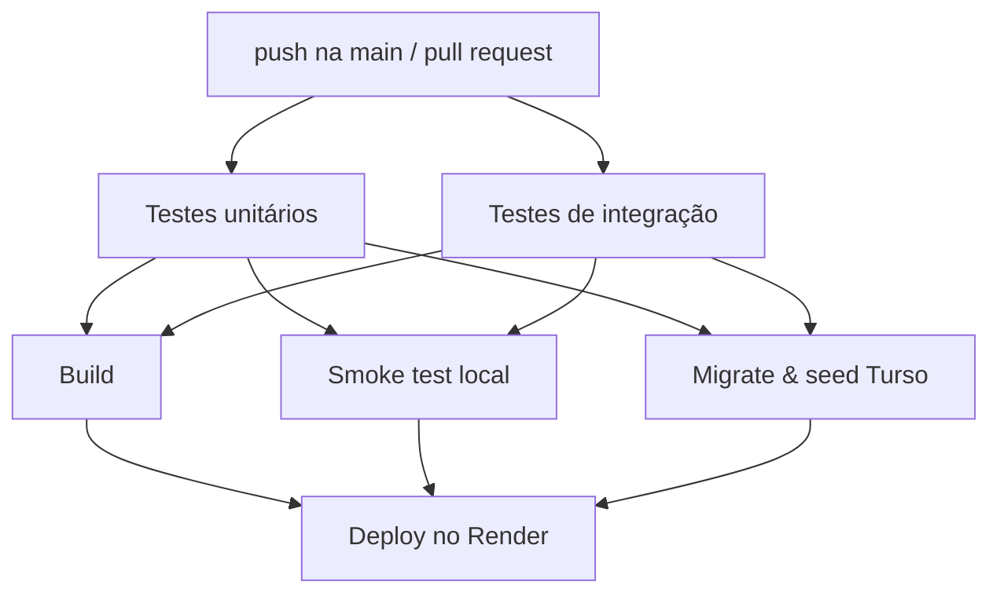

# CI/CD — GitHub Actions + Turso + Render

Documentação completa do pipeline de integração e entrega contínua do projeto.

- Workflow: [`.github/workflows/ci.yml`](../.github/workflows/ci.yml)
- Banco: [Turso/libSQL](database.md)
- Health check: [GET /api/health](health.md)
- Deploy: [Render](https://render.com)
- Badge: [](https://github.com/madsondecarvalho/uern-projeto-backend-biblioteca/actions/workflows/ci.yml)

---

## 1. Visão geral

O pipeline valida cada alteração e controla a ordem em que o banco e a aplicação são atualizados:

1. roda testes unitários;
2. roda testes de integração dos models;
3. valida o "build" (carregamento da aplicação com dependências de produção);
4. executa um smoke test de ponta a ponta com SQLite local;
5. aplica migrations e seed no Turso;
6. dispara o deploy no Render, somente depois de tudo passar.



> `Build`, `Smoke test` e `Migrate & seed` rodam em paralelo depois dos testes.
> O deploy só roda em push para `main`, depois que todos terminarem com sucesso.

## 2. Arquivos envolvidos

| Arquivo | Responsabilidade |
|---------|------------------|
| `.github/workflows/ci.yml` | Definição dos jobs, triggers, secrets e ordem do pipeline |
| `.nvmrc` | Versão do Node usada no CI e no Render (22) |
| `package.json` | Scripts `test:unit`, `test:integration`, `build`, `smoke` e `db:*` |
| `scripts/build-check.js` | Valida que a aplicação carrega com dependências de produção |
| `scripts/smoke.js` | Smoke test HTTP do fluxo principal |
| `scripts/db/schema.js` | Schema SQL idempotente (tabelas e índices) |
| `scripts/db/migrate.js` | Aplica o schema no banco configurado |
| `scripts/db/seed.js` | Insere dados de demonstração se o banco estiver vazio |
| `scripts/db/check.js` | Valida tabelas obrigatórias e mostra contagens |
| `jest.config.cjs` / `babel.config.cjs` | Configuração dos testes Jest |
| `tests/*.test.js` | Testes unitários de controllers, services, schemas e health |
| `tests/database.integration.test.js` | Testes de integração dos models com SQLite em memória |

## 3. Quando o pipeline roda

| Evento | Comportamento |
|--------|---------------|
| `push` na `main` | Executa testes, build, smoke, migrations e deploy |
| `pull_request` | Executa testes, build e smoke; **não** roda migrations nem deploy |
| `workflow_dispatch` | Execução manual pela aba **Actions**; para migrations, a branch precisa ser `main`; o deploy não roda |

### Concorrência

Execuções novas no mesmo ref cancelam a anterior ainda em andamento:

```yaml
concurrency:
  group: ci-${{ github.workflow }}-${{ github.ref }}
  cancel-in-progress: true
```

### Permissões

O workflow usa apenas leitura do repositório:

```yaml
permissions:
  contents: read
```

## 4. Jobs do pipeline

### 4.1 `Testes unitários`

| Item | Valor |
|------|-------|
| Runner | `ubuntu-latest` |
| Timeout | 10 minutos |
| Depende de | — |
| Comando | `npm run test:unit` |

O script executa o Jest com cobertura, ignorando o arquivo de integração:

```bash
jest --runInBand --coverage --testPathIgnorePatterns=integration.test.js
```

Cobre controllers, services, schemas e health check, com o banco mockado. O relatório `coverage/` é publicado como artefato por **7 dias**.

### 4.2 `Testes de integração`

| Item | Valor |
|------|-------|
| Runner | `ubuntu-latest` |
| Timeout | 10 minutos |
| Depende de | — |
| Comando | `npm run test:integration` |

Executa os models reais contra um SQLite em memória:

```bash
jest --runInBand tests/database.integration.test.js
```

Valida CRUD, filtros, paginação, joins, unicidade, referências e cascatas. Não depende do Turso remoto nem de serviços externos.

### 4.3 `Build`

| Item | Valor |
|------|-------|
| Runner | `ubuntu-latest` |
| Timeout | 10 minutos |
| Depende de | Testes unitários + integração |
| Comandos | `npm ci --omit=dev` e `npm run build` |

Como a API é Express/Node e não tem bundler, o build valida o carregamento da aplicação:

```bash
npm run build   # node scripts/build-check.js
```

O script importa `src/app.js`, carregando rotas, controllers, services, models, schemas e configurações. Falha em caso de erro de sintaxe, import quebrado ou dependência de produção ausente.

### 4.4 `Smoke test (API + Turso local)`

| Item | Valor |
|------|-------|
| Runner | `ubuntu-latest` |
| Timeout | 15 minutos |
| Depende de | Testes unitários + integração |
| Banco | SQLite local em `file:./ci.db` |

Fluxo:

1. `npm ci`
2. `npm run db:setup` (schema + seed)
3. inicia `node server.js` em background
4. faz polling em `GET /api/health` por até 30 segundos
5. roda `npm run smoke`
6. encerra a API ao final (e mostra o log em caso de falha)

O `npm run smoke` valida:

- health check com banco `up`;
- listagem de livros com `Author` e `Category`;
- login de usuário e administrador;
- listagem de usuários sem o campo `password`;
- listagem de cópias disponíveis;
- criação de reserva;
- confirmação de retirada (`PICKED_UP`);
- atualização da cópia para `BORROWED`.

Variáveis do job:

| Variável | Valor |
|----------|-------|
| `TURSO_DATABASE_URL` | `file:./ci.db` |
| `JWT_SECRET` | `ci-secret` |
| `NODE_ENV` | `test` |
| `PORT` | `3333` |

> Esse job usa banco local de propósito: o smoke test não altera o Turso de staging/produção.

### 4.5 `Migrate & seed (Turso)`

| Item | Valor |
|------|-------|
| Runner | `ubuntu-latest` |
| Timeout | 10 minutos |
| Depende de | Testes unitários + integração |
| Condição | `github.ref == 'refs/heads/main'` e evento `push` ou `workflow_dispatch` |
| Banco | Turso remoto |
| Secrets | `TURSO_DATABASE_URL`, `TURSO_AUTH_TOKEN` |

Passos:

1. verifica se os dois secrets existem;
2. se faltar algum, registra `::warning::`, marca `configured=false` e ignora a etapa;
3. `npm ci`;
4. `npm run db:migrate`;
5. `npm run db:seed` (idempotente);
6. `npm run db:check`.

#### Comportamento do seed

- Em banco vazio: insere autores, categorias, livros, usuários e cópias de demonstração.
- Em banco com dados: imprime `Seed ignorado: o banco já possui dados.` e não duplica nada.
- Em execução manual, o input **`seed`** (padrão `true`) permite rodar apenas migrations.

#### Validação final

`npm run db:check` confirma a existência das tabelas:

- `Authors`
- `Books`
- `Categories`
- `Copies`
- `Reservations`
- `Users`

Também mostra a quantidade de registros e falha se alguma tabela obrigatória estiver faltando.

#### Output do job

O job expõe:

```yaml
outputs:
  configured: ${{ steps.check.outputs.configured }}
```

O deploy usa esse output para não acontecer quando as migrations não puderam rodar por falta de secrets.

### 4.6 `Deploy no Render`

| Item | Valor |
|------|-------|
| Runner | `ubuntu-latest` |
| Timeout | 5 minutos |
| Depende de | Testes unitários, integração, build, smoke e migrations |
| Condição | `push` na `main` + migrations configuradas |
| Secret | `RENDER_DEPLOY_HOOK_URL` |

O job envia um `POST` para o Deploy Hook do Render, com retry:

```bash
curl --fail --silent --show-error --retry 3 --retry-delay 5 \
  --request POST "$RENDER_DEPLOY_HOOK_URL"
```

Se o secret não existir, o job registra um aviso e termina com sucesso.

> O deploy é assíncrono: o job confirma que o Render aceitou o pedido, mas não espera a aplicação ficar `live`. O Render usa o **Health Check Path** `/api/health` para validar a nova versão.

## 5. Resumo das dependências

| Job | Depende de | Roda em PR | Roda em push main | Roda manual |
|-----|------------|------------|-------------------|-------------|
| Testes unitários | — | Sim | Sim | Sim |
| Testes de integração | — | Sim | Sim | Sim |
| Build | Testes | Sim | Sim | Sim |
| Smoke test | Testes | Sim | Sim | Sim |
| Migrate & seed | Testes | Não | Sim | Sim (branch main) |
| Deploy no Render | Todos + migrations | Não | Sim | Não |

## 6. Configuração no GitHub

### 6.1 Secrets obrigatórios

Em **Settings → Secrets and variables → Actions → New repository secret**:

| Secret | Uso | Valor |
|--------|-----|-------|
| `TURSO_DATABASE_URL` | Migrations/seed | `libsql://seu-banco-sua-org.turso.io` |
| `TURSO_AUTH_TOKEN` | Migrations/seed | token de leitura/escrita do Turso |
| `RENDER_DEPLOY_HOOK_URL` | Deploy | URL do Deploy Hook do Render |

> Se os secrets estiverem em um **GitHub Environment** (ex.: `staging`), o job precisa declarar `environment: staging`. O workflow atual usa secrets de repositório.

### 6.2 Secret do Turso

1. No dashboard do Turso, abra o banco.
2. Copie a URL (`libsql://...`).
3. Gere um token de leitura/escrita.
4. Cadastre os dois secrets no GitHub.

Sem eles, o job de migrations é ignorado e o deploy pelo Actions não acontece.

> Pull requests vindos de forks não recebem secrets do repositório. Como migrations e deploy não rodam em PRs, isso não afeta o fluxo normal.

### 6.3 Secret do Render

1. No Render: serviço → **Settings → Deploy Hook**.
2. Copie a URL.
3. Cadastre `RENDER_DEPLOY_HOOK_URL` no GitHub.

A URL tem o formato:

```text
https://api.render.com/deploy/srv-xxxxxxxxxxxxx?key=yyyyyyyyyyyy
```

Ela funciona como uma senha: qualquer pessoa com a URL pode disparar deploys. Se vazar, use **Regenerate Hook** no Render e atualize o secret.

### 6.4 Proteção da branch

Em **Settings → Branches → Branch protection rules** para `main`, marque como obrigatórios os checks que rodam em pull requests:

- `Testes unitários`
- `Testes de integração`
- `Build`
- `Smoke test (API + Turso local)`

`Migrate & seed (Turso)` e `Deploy no Render` rodam apenas em push/manual na `main`, portanto não aparecem em PRs.

## 7. Configuração no Render

| Configuração | Valor |
|--------------|-------|
| **Build Command** | `npm ci && npm run build` |
| **Start Command** | `npm start` |
| **Health Check Path** | `/api/health` |
| **Node** | definido pelo [`.nvmrc`](../.nvmrc) (22) |
| **Variáveis** | `TURSO_DATABASE_URL`, `TURSO_AUTH_TOKEN`, `JWT_SECRET`, `FRONTEND_URLS` (CORS) |

O Render não roda migrations automaticamente no start. O job de CI faz isso antes de disparar o deploy.

Para rodar manualmente contra o Turso:

```bash
npm run db:migrate
npm run db:seed     # opcional
npm run db:check
```

### 7.1 Auto-Deploy × Deploy Hook

| Auto-Deploy no Render | Secret no GitHub | Resultado |
|-----------------------|------------------|-----------|
| Ligado | Ausente | Render faz deploy a cada push; o CI valida e roda migrations, mas o deploy pode ocorrer antes delas |
| Desligado | Configurado | Deploy só acontece após testes, build, smoke e migrations |
| Ligado | Configurado | **Dois deploys por push** — evite |
| Desligado | Ausente | Nenhum deploy automático |

> Para garantir que as migrations rodem **antes** do deploy, desligue o Auto-Deploy e use o Deploy Hook.

## 8. Cobertura e qualidade

- O job de testes unitários gera cobertura e publica o artefato `coverage` por 7 dias.
- O job de integração valida os models reais, mas não publica relatório de cobertura separado.
- **Não há threshold mínimo de cobertura configurado** no CI: uma cobertura baixa não reprova o pipeline.
- Também não há etapa de lint nem auditoria de dependências no pipeline atual.
- O smoke test cobre o fluxo HTTP principal, mas não substitui testes E2E contra o Render.

## 9. Execução manual

### Pela interface

1. Abra o repositório no GitHub.
2. Vá em **Actions → CI**.
3. Clique em **Run workflow**.
4. Selecione a branch `main`.
5. Marque ou desmarque **Rodar o seed após as migrations**.
6. Execute.

O que acontece:

- testes, build e smoke rodam;
- migrations e seed rodam no Turso;
- deploy **não** roda, pois o evento é `workflow_dispatch`.

### Pela CLI

```bash
# Rodar com seed
gh workflow run CI --ref main -f seed=true

# Rodar apenas migrations
gh workflow run CI --ref main -f seed=false

# Acompanhar
gh run list --workflow=CI --limit 5
gh run watch <RUN_ID> --exit-status
gh run view <RUN_ID> --log
```

## 10. Rodando as mesmas etapas localmente

```bash
npm ci
npm run test:unit
npm run test:integration
npm run build
```

Smoke test local:

```bash
npm run db:setup
npm start
# em outro terminal:
npm run smoke
curl http://localhost:3333/api/health
```

Migrations contra o Turso:

```bash
TURSO_DATABASE_URL=libsql://... TURSO_AUTH_TOKEN=... npm run db:migrate
```

No Windows/PowerShell:

```powershell
$env:TURSO_DATABASE_URL = 'libsql://...'
$env:TURSO_AUTH_TOKEN = '...'
npm run db:migrate
npm run db:check
```

## 11. Segurança

- Nunca commite `.env` nem tokens.
- Use **GitHub Secrets** para URL/token do Turso e Deploy Hook.
- O workflow tem apenas `contents: read`.
- O Deploy Hook e o token do Turso devem ser rotacionados se vazarem.
- Logs não devem imprimir secrets; o GitHub mascara valores cadastrados.
- Se o push for bloqueado por falta do escopo `workflow`, rode:

```bash
gh auth refresh -s workflow
```

## 12. Problemas comuns

| Sintoma | Causa provável | Solução |
|---------|----------------|---------|
| `Migrate & seed` não aparece | Evento é PR ou branch diferente de `main` | Faça push/manual na `main` |
| Job de migrations com aviso | Secrets do Turso ausentes no GitHub | Cadastre `TURSO_DATABASE_URL` e `TURSO_AUTH_TOKEN` |
| Deploy skipped | Migrations não configuradas ou evento não é push na `main` | Verifique o output `configured` e o evento |
| Tabelas ausentes no Turso | Migration não rodou ou falhou | Veja o log do job e rode o workflow manualmente |
| `no such table` na API | Schema não aplicado | Rode `npm run db:migrate` ou o job de migrations |
| `401`/`403` no Turso | Token inválido ou sem permissão | Gere outro token e atualize o secret |
| `/api/health` retorna `503` | API no ar, banco indisponível | Verifique URL, token, migrations e logs do Render |
| Seed não insere nada | Banco já tem dados | Esperado: seed é idempotente |
| Dois deploys por push | Auto-Deploy ligado + Deploy Hook configurado | Desligue o Auto-Deploy ou remova o secret |
| Build falha | Import/sintaxe/dependência quebrada | Rode `npm run build` localmente |
| Smoke test falha | API não subiu ou fluxo HTTP quebrou | O job imprime `server.log`; rode `npm run smoke` localmente |
| Cobertura não publicada | Testes unitários falharam antes de gerar `coverage/` | Corrija os testes e rode `npm run test:unit` |
| Push rejeitado por `workflow` scope | Token OAuth sem permissão para alterar workflows | `gh auth refresh -s workflow` |
| Aviso de Node.js 20 deprecated | Actions antigas rodando no runner | Aviso não bloqueante; atualize as actions quando necessário |

## 13. Limitações atuais

- O deploy no Render é disparado por hook e não é aguardado pelo Actions.
- O smoke test usa SQLite local, não o Turso remoto.
- O job de migrations valida o schema, mas não faz backup antes de alterações.
- Não há lint, auditoria de dependências ou threshold de cobertura.
- Migrations são idempotentes (`CREATE TABLE IF NOT EXISTS`), mas mudanças futuras de coluna exigirão scripts de alteração.
- O seed contém dados de demonstração; não use em produção com dados reais.

## 14. Checklist de configuração

- [ ] `.nvmrc` e `engines` com Node 22.
- [ ] Secrets `TURSO_DATABASE_URL` e `TURSO_AUTH_TOKEN` no GitHub.
- [ ] Secret `RENDER_DEPLOY_HOOK_URL` no GitHub.
- [ ] Variáveis do Turso e `JWT_SECRET` no Render.
- [ ] Health Check Path `/api/health` no Render.
- [ ] Auto-Deploy desligado se o CI controla o deploy.
- [ ] Checks de PR obrigatórios na branch `main`.
- [ ] Primeira execução manual com `seed=true` para criar as tabelas e dados.
- [ ] `GET /api/health` retornando `200` após o deploy.
